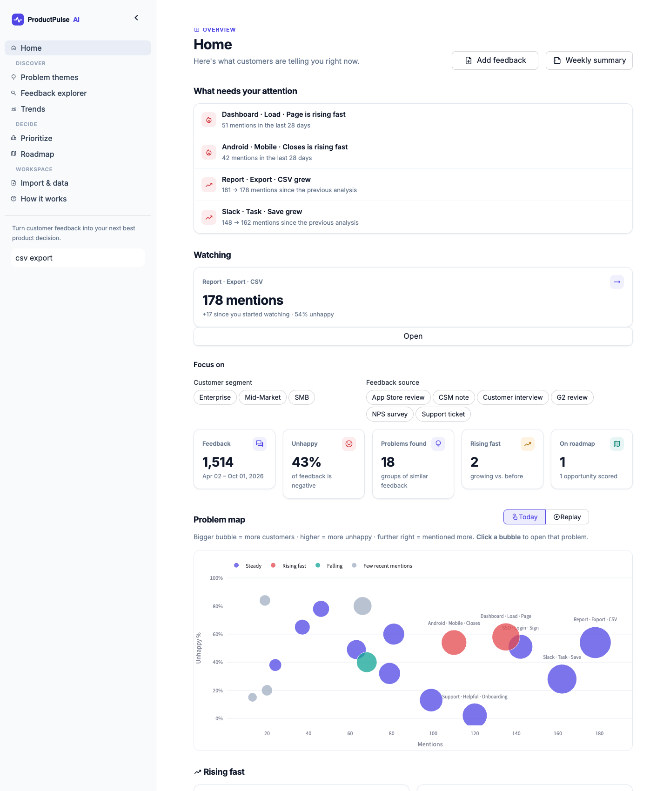
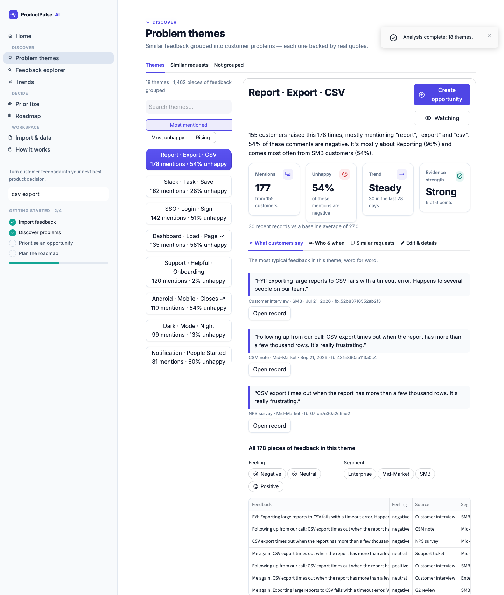
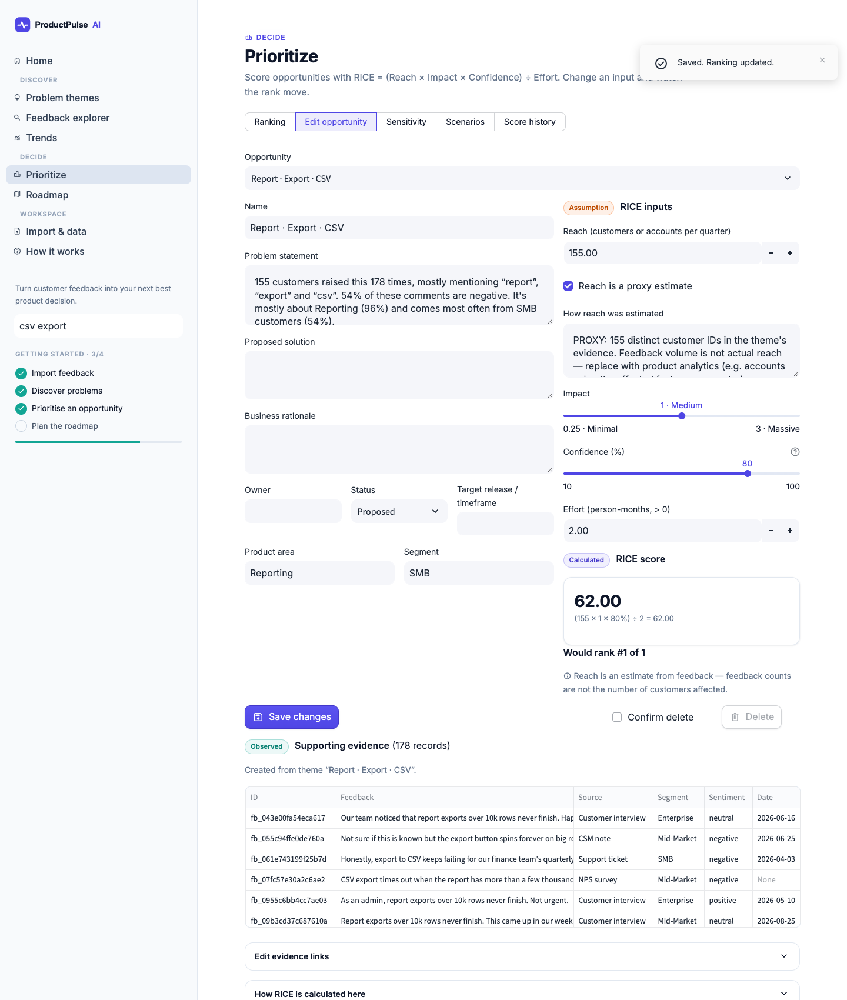
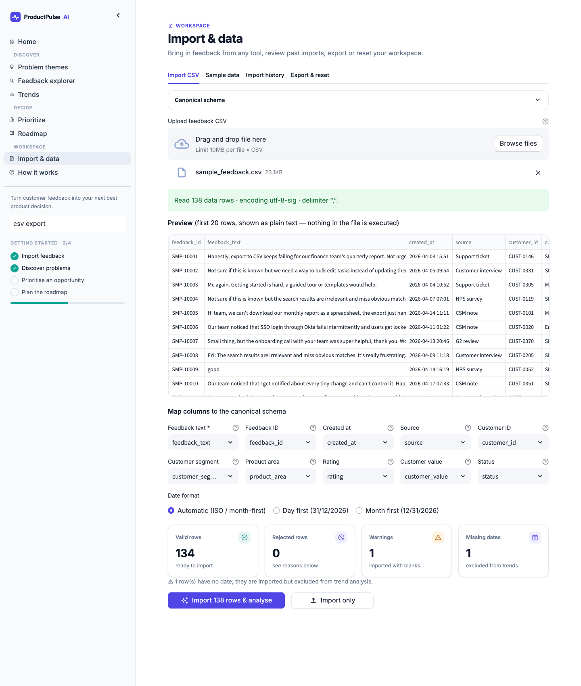
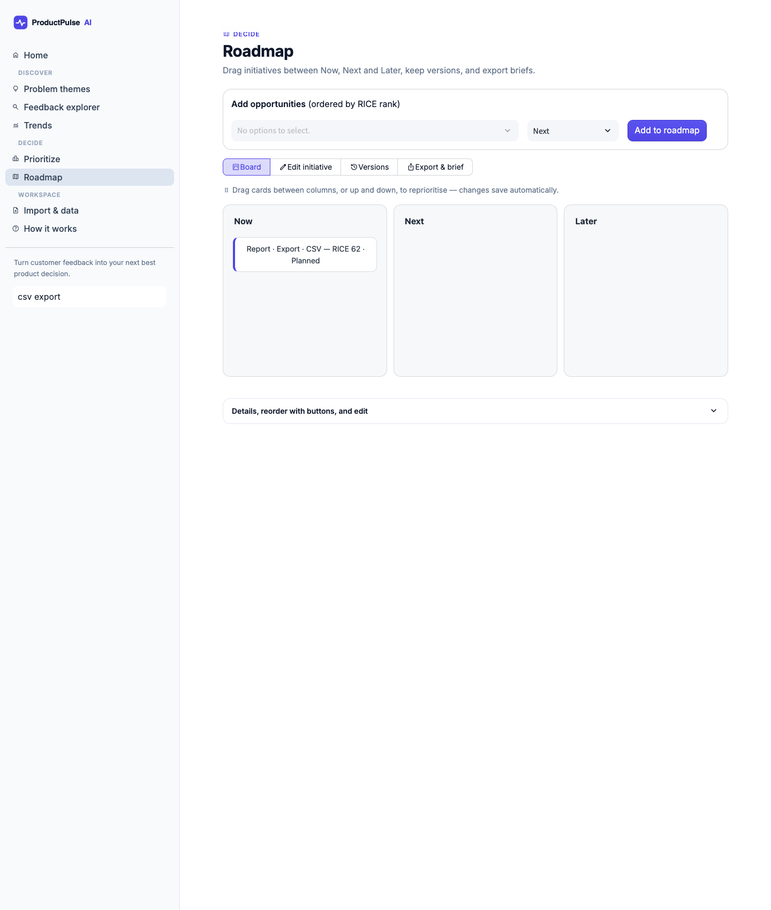
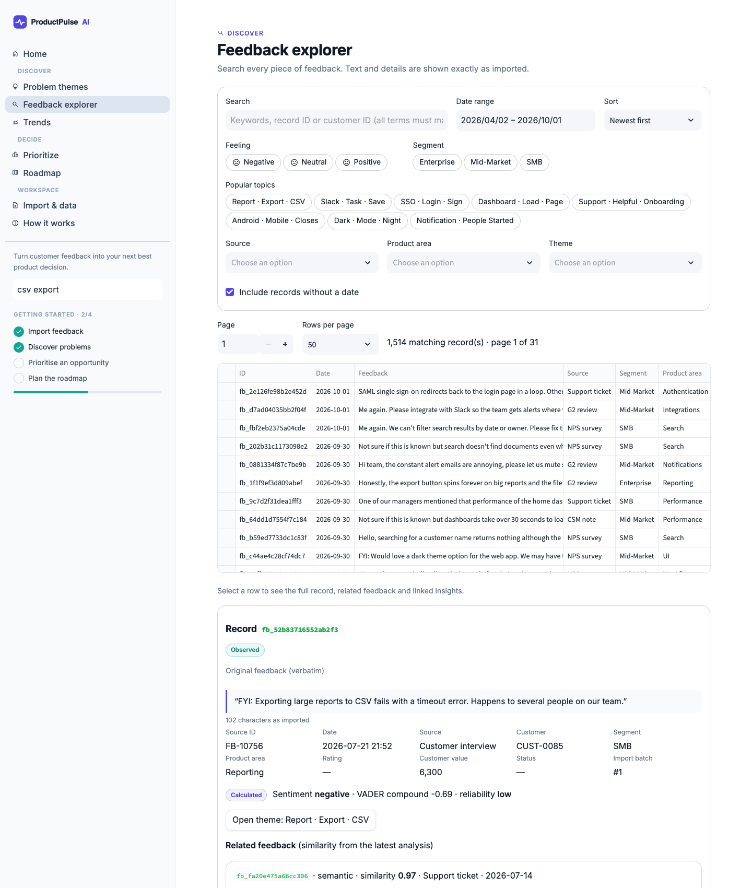
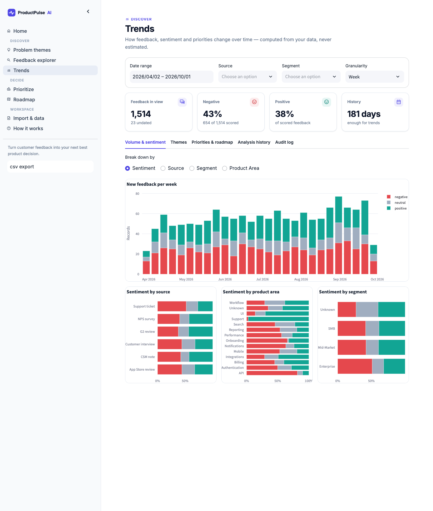

# ProductPulse AI

**Turn customer feedback into your next best product decision.**

ProductPulse AI is a Streamlit web app that turns scattered customer feedback into problem themes you can trace back to evidence, a transparent RICE prioritisation, and a versioned roadmap with exportable product briefs. Every insight links back to the actual feedback records behind it. Quotes are always copied verbatim, never generated.

It runs fully locally with **no API keys**. An LLM can optionally write theme summaries. Its output is validated against the evidence, and any failure falls back to a deterministic summary.



> All bundled data is **synthetic**: a fictional B2B SaaS product, customers and quotes generated by `scripts/generate_synthetic_data.py`. No real customer data is included.

---

## What it does

| Area | What you can do |
|---|---|
| **Import & Data** | Upload a CSV, map your columns to the canonical schema, and preview and validate it (encoding, dates, malformed rows, duplicates, limits). Download rejected rows with reasons, keep an import history, re-import safely, delete an import, or reset the workspace. |
| **Problem Themes** | Run the analysis: VADER sentiment with a product-feedback lexicon, Sentence-Transformers embeddings (TF-IDF fallback), agglomerative/HDBSCAN clustering and c-TF-IDF labels. Each theme page shows a problem statement, verbatim quotes with record links, a sentiment/segment/area breakdown, a trend against a baseline, and an evidence-quality score. You can rename, merge, split, or remove themes. Duplicate and similar requests can be reviewed but are never merged automatically. |
| **Feedback Explorer** | Full-text search, filters (date, source, sentiment, area, segment, theme), sorting, pagination, the full record view, related feedback, and links to themes and opportunities. |
| **Prioritize** | Opportunities with RICE recalculated live (the formula and inputs are always shown), reach clearly flagged when it is a *proxy*, a sortable and filterable ranking, sensitivity analysis, saved and restorable scenarios, and score history. |
| **Roadmap** | Now/Next/Later (or custom) horizons, ordering, owners, status, dates, dependencies and rationale. Save versions, compare them, and export as CSV/Markdown along with nine-section product briefs. |
| **Trends** | Volume and sentiment over time and by source, segment and area. Theme frequency changes, priority-score history, roadmap change history, a theme → opportunity → roadmap Sankey diagram, analysis-run snapshots and the audit log. |
| **How it works** | Active configuration, how every number is calculated, the privacy note and known limitations. |

**Interactive by design:** click a bubble on the Home *problem map* to open that problem; filter everything with one-click segment, source and feeling chips; drag initiatives between Now / Next / Later on the roadmap; click a dot on the value-vs-effort matrix to edit it; and watch an opportunity's rank update live as you change its RICE inputs.

**Motion with a purpose:** KPI numbers count up, cards and alerts fade in with a short stagger, sentiment bars grow in, rising problems pulse, and the problem map has a **Replay** mode that animates six months of feedback week by week. All motion is disabled for users who prefer reduced motion.

**Built for weekly use:** Home greets returning users with what changed since their last visit (new feedback, new, growing and rising problems), a **watchlist** of problems they follow (it survives re-analysis), one-click **Add feedback** that remembers your CSV's column mapping and re-analyses in one step, a ready-to-paste **weekly summary**, and quick search from the sidebar on every page.

Core journey: **import → analyse → discover a problem → inspect evidence → create an opportunity → prioritise → roadmap → export a brief → inspect history.** This journey is automated in `tests/test_e2e.py` (services) and `scripts/ui_journey.py` (real browser).

| | |
|---|---|
|  |  |
|  |  |
|  |  |

## Quick start (local)

Requires Python 3.12 (3.11 also resolves). The commands below are for macOS/Linux.

```bash
git clone https://github.com/priyanshshrivastava38-create/Product-management-tool-.git productpulse-ai && cd productpulse-ai
python3.12 -m venv .venv && source .venv/bin/activate
pip install -r requirements.txt          # ~2 min; CPU-only PyTorch
streamlit run streamlit_app.py           # http://localhost:8501
```

Then click **Try it with sample data** on the Home page. The first analysis downloads the ~90 MB `all-MiniLM-L6-v2` model from Hugging Face. Later runs use the local cache plus an embedding cache in the database.

To try the import flow, go to **Import & Data → Sample data**. Download `messy_feedback_example.csv` (non-standard headers, bad dates, malformed rows) and upload it.

No `.env` is required. To change defaults, `cp .env.example .env` (see [Configuration](#configuration)).

## Tests, lint and checks

```bash
pip install -r requirements-dev.txt
pytest                                   # 111 passed, 2 skipped (opt-in suites) — see below
ruff check . && ruff format --check .
python scripts/healthcheck.py --with-model            # deployment health check
python scripts/evaluate.py                            # reproduces docs/AI_EVALUATION.md numbers
```

Opt-in suites:
- `PRODUCTPULSE_RUN_SEMANTIC=1 pytest -m semantic` runs the real embedding model.
- `PRODUCTPULSE_TEST_POSTGRES_URL=postgresql+psycopg2://… pytest tests/test_postgres.py` needs an empty, disposable database.
- Browser journey: start the app on an empty DB, then run `python scripts/ui_journey.py --url http://localhost:8501 --full-sample`. It uses your local Chrome; pass `--browser chromium` after `playwright install chromium` to use Playwright's bundled browser instead.

## Configuration

All settings are optional environment variables (or Streamlit secrets) prefixed `PRODUCTPULSE_`:

| Variable | Default | Purpose |
|---|---|---|
| `DATABASE_URL` | `sqlite:///data/productpulse.db` | SQLAlchemy URL. Use `postgresql+psycopg2://…` for durable hosted storage |
| `MAX_UPLOAD_MB` / `MAX_IMPORT_ROWS` | 10 / 20000 | Upload limits (also set `server.maxUploadSize` in `.streamlit/config.toml`) |
| `MAX_ANALYSIS_ROWS` | 6000 | Most-recent records analysed per run |
| `EMBEDDING_BACKEND` | `auto` | `auto`, `sentence-transformers` or `tfidf` (no model download, lower quality) |
| `EMBEDDING_MODEL` | `sentence-transformers/all-MiniLM-L6-v2` | Any Sentence-Transformers model |
| `LLM_PROVIDER` / `LLM_API_KEY` / `LLM_MODEL` / `LLM_BASE_URL` / `LLM_TIMEOUT_SECONDS` | `none` | Optional summaries: `anthropic` (default model `claude-opus-5-5`) or `openai` (any OpenAI-compatible endpoint) |

## Deployment

The target is **Streamlit Community Cloud**. Full steps and troubleshooting are in [docs/DEPLOYMENT.md](docs/DEPLOYMENT.md). In short:

1. Push this repo to GitHub.
2. On share.streamlit.io, create an app with main file `streamlit_app.py` and Python **3.12** (Advanced settings).
3. Optional: add secrets such as `PRODUCTPULSE_DATABASE_URL` (PostgreSQL) or the LLM settings.

**Storage caveat:** Community Cloud's filesystem is ephemeral, so the default SQLite workspace resets whenever the app restarts or redeploys. That's fine for a demo, because the sample loads in one click. For persistence, point `PRODUCTPULSE_DATABASE_URL` at a managed PostgreSQL database. PostgreSQL was tested locally (PostgreSQL 16) with `tests/test_postgres.py`.

This repository has **not** been deployed to a public URL as part of this build. Hosting needs your GitHub and Streamlit accounts.

## Project structure

```
streamlit_app.py            entry point: config, secrets bridge, navigation
productpulse/
  config.py                 pydantic-settings configuration
  db/                       SQLAlchemy models + engine/session/schema init
  ingestion/csv_import.py   parse → map → validate → import
  analysis/                 sentiment, embeddings, clustering, labeling, similarity, trends, pipeline
  llm/provider.py           optional LLM summaries with validation + fallback
  services/                 feedback search, themes, prioritization, roadmap, analytics, audit, workspace
  exports/briefs.py         product brief / roadmap Markdown, CSV (formula-injection safe)
  ui/                       theme, shared state/actions, one module per page (ui/views)
  sample_data.py            deterministic synthetic data generator
data/sample/                bundled synthetic datasets (+ ground truth used only for evaluation)
scripts/                    generate data, health check, evaluation, example brief, browser journey
tests/                      pytest suite (+ hand-labelled sentiment set)
docs/                       PRD, architecture, metrics, AI evaluation, decisions, roadmap, deployment, examples
```

## Documentation

[PRD](docs/PRD.md) · [Architecture](docs/ARCHITECTURE.md) · [Product metrics](docs/PRODUCT_METRICS.md) · [AI evaluation](docs/AI_EVALUATION.md) · [Decisions](docs/DECISIONS.md) · [Roadmap](docs/ROADMAP.md) · [Deployment](docs/DEPLOYMENT.md) · [Example product brief](docs/examples/product_brief_example.md)

## Limitations (summary)

- Sentiment is lexicon-based and English-centric. It misreads sarcasm (see the evaluation for examples).
- Clustering is unsupervised, so themes need human curation. The TF-IDF fallback is much weaker on paraphrases.
- The evaluation data was written by the author (synthetic and hand-labelled). The metrics show behaviour on controlled data, not real-world accuracy.
- Reach suggested from feedback is a proxy, and it is labelled as one everywhere.
- Analysis runs synchronously in the web process. Large datasets are capped by `MAX_ANALYSIS_ROWS`.
- There is no authentication or multi-user access control. This is a single-workspace demo application, not a security-audited product.
